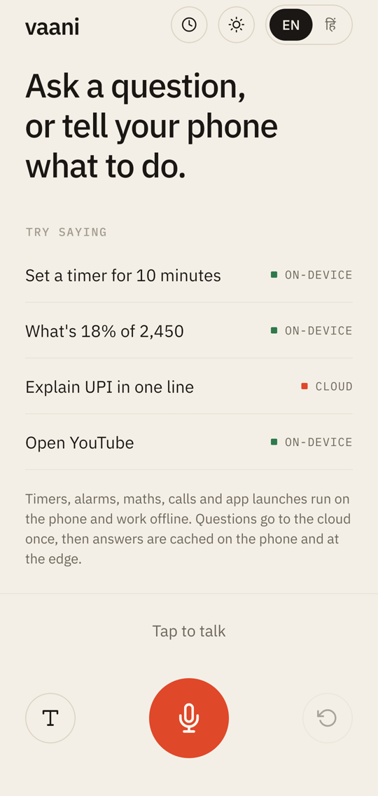
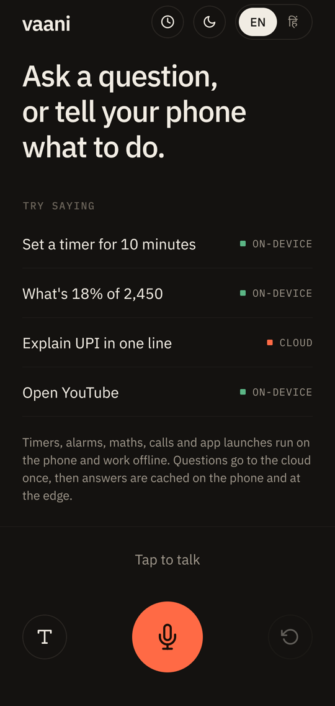
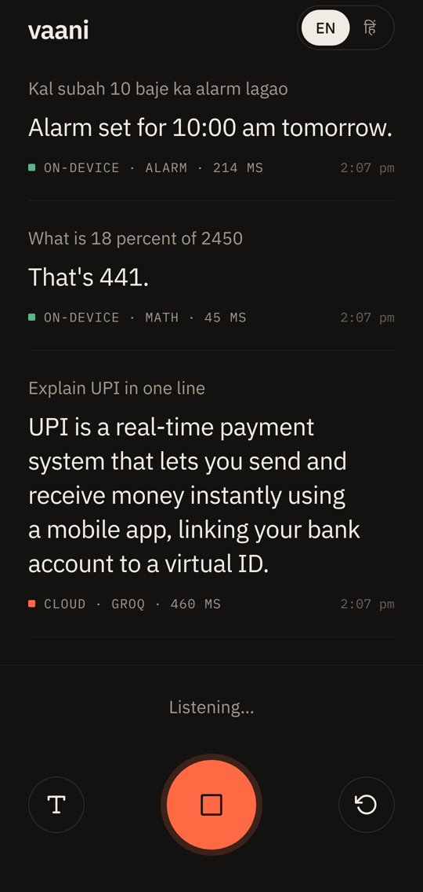
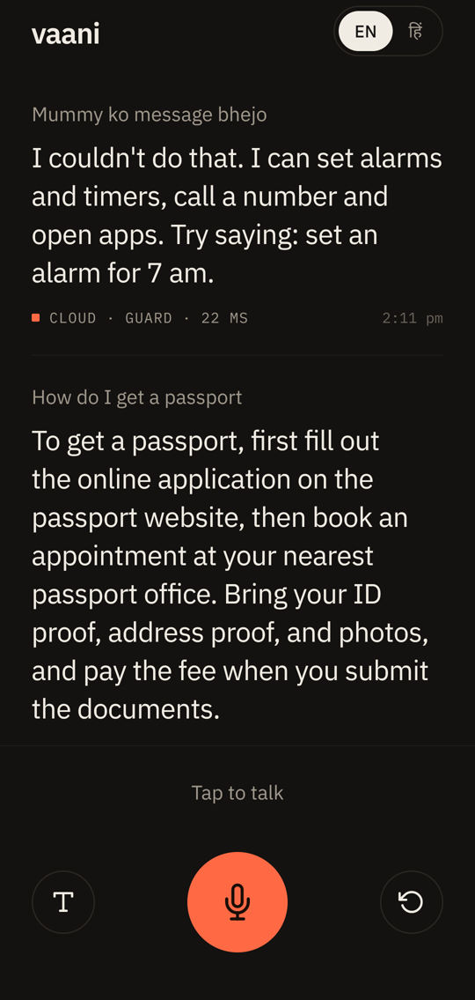
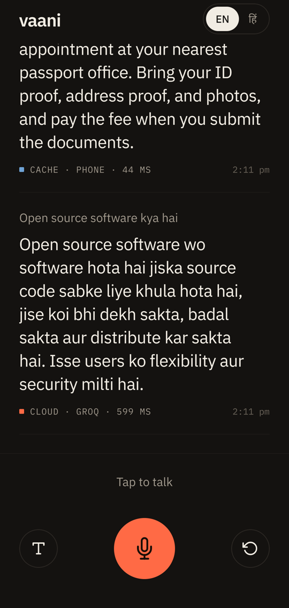
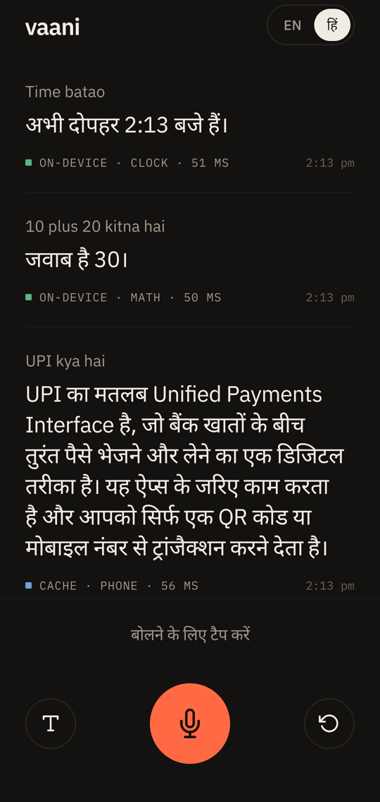
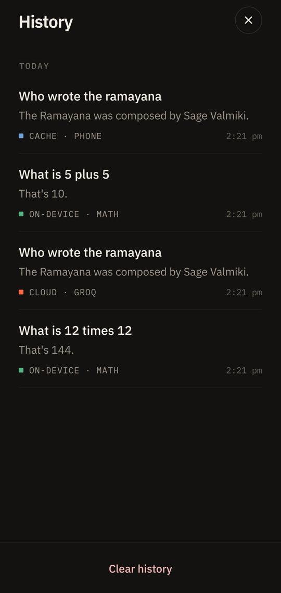

# Vaani

A single-screen Android voice assistant (React Native / Expo SDK 58) with a stateless Node.js backend (Hono) that runs on Cloudflare Workers. It is designed for 10 lakh (1 million) concurrent users and demonstrated entirely on free tiers.

**Design report:** [docs/DESIGN.md](docs/DESIGN.md) covers constraints, decisions and trade-offs, the caching design, a capacity model for 10 lakh concurrent users, a cost model, measured numbers and [known limitations](docs/DESIGN.md#13-known-limitations).

## Screenshots

Taken on a Realme RMX3360 (Android 13). The tag under every answer shows where it was computed and how long it took: `ON-DEVICE`, `CACHE · PHONE`, `CACHE · EDGE` or `CLOUD · <provider>`.

| Home (light and dark) | | Where each answer comes from |
|---|---|---|
|  |  |  |
| The header has History, a theme button (System → Light → Dark, remembered) and EN/हिं. Suggestions show which commands run on the phone. | | A Hinglish alarm ("kal subah 10 baje…") and maths run **on the phone** in milliseconds; only the open question goes to the **cloud**. |

| Three cache tiers | Honest about what it can't do | Questions never become actions |
|---|---|---|
|  |  |  |
| First ask: **cloud**, 573 ms. Same question with "please": **phone cache**, 53 ms. Reworded: **edge cache**, 29 ms. | "Mummy ko message bhejo" gets an honest "I couldn't do that" with no LLM call, instead of a made-up "message sent". "How do I get a passport" is answered, not turned into navigation. | "Open source software kya hai" is a question, so it is answered (in Hinglish) instead of opening an app. |

| Hindi mode | History |
|---|---|
|  |  |
| Time and maths answered on the phone in natural Hindi ("अभी दोपहर 2:13 बजे हैं"); the cloud answers in Devanagari; the UI and voice switch to Hindi. | Every command, newest first, grouped by day, with where it was answered. Tap one to ask again. The clear button only clears the screen; history (last 200, on the phone) has its own "Clear history" with a confirmation. |

## How a command flows

1. **Speech to text on the phone.** Android `SpeechRecognizer` tries offline recognition first and falls back to the phone's online recogniser if the language pack isn't downloaded. Either way, audio never reaches our servers.
2. **On-device intent router** (`app/src/intents.ts`). It handles timers, alarms, calls, opening apps, search, directions, time, date, battery and maths locally, in English, Hinglish and Hindi. These commands need no network and cost nothing.
3. **Phone answer cache.** If this phone has asked the question before, the answer is spoken instantly, even offline.
4. **Cloud only for new open questions.** The phone sends text only (about 100 bytes) to `POST /v1/ask`. The server:
   - decides whether the question is a follow-up ("who runs it?"). Follow-ups keep their history; everything else is treated as stand-alone and becomes cacheable.
   - normalises the question and checks a three-tier cache: the isolate's memory (L1), then **Workers KV** shared across every edge location (L2)
   - coalesces identical in-flight questions into one LLM call
   - calls the provider chain **Groq gpt-oss-20b → Groq gpt-oss-120b → OpenRouter**, with circuit breakers on 429 and 5xx errors
5. **Text to speech on the phone** (system TTS).

Each answer is tagged in the UI with where it was computed (`ON-DEVICE`, `CACHE · PHONE`, `CACHE · EDGE` or `CLOUD · groq`) and how long it took.

## Run it

### Backend

```bash
cd backend
npm install
cp .env.example .env      # add a free Groq key; with none it runs in demo (mock) mode
npm run dev               # http://localhost:8787
npm test                  # 28 tests
npm run bench             # load test on one process (mock LLM)
```

Free keys, no card required:
- [Groq](https://console.groq.com/keys) (primary)
- [OpenRouter](https://openrouter.ai/keys) (optional last-resort fallback)

**Deploy free on Cloudflare Workers.** The same code runs there, with 100k requests/day, no cold-start sleep, and Workers KV as the shared answer cache:

```bash
npx wrangler login
npx wrangler kv namespace create vaani-answers   # put the printed id in wrangler.toml
npx wrangler secret put GROQ_API_KEY
npx wrangler secret put OPENROUTER_API_KEY       # optional
npm run deploy:cf
```

Check it with `curl https://<your-worker>.workers.dev/healthz`. The response should include `"cache":"kv"`.

The alternative is Render's free tier for Node (`deploy/render.yaml`, with optional Upstash Redis as the shared cache). For the scaled production setup, see `Dockerfile` and `deploy/k8s.yaml`.

### Android app

Speech recognition is a native module, so the app needs a development build. Expo Go won't work.

```bash
cd app
npm install
npm test                  # 42 tests: intent router (English, Hinglish, Hindi) + phone cache keys
```

Then build it one of two ways.

**Option A: cloud build, nothing to install locally** (EAS free plan: 15 Android builds/month)

```bash
# set EXPO_PUBLIC_API_URL in eas.json "preview" to your deployed backend URL first
npx eas-cli@latest login
npm run build:apk         # gives a link to an installable APK
```

**Option B: local build** (needs Android Studio + SDK)

```bash
EXPO_PUBLIC_API_URL=http://10.0.2.2:8787 npx expo run:android
```

On a real phone, point `EXPO_PUBLIC_API_URL` at your laptop's LAN IP or your deployed HTTPS backend.

## Repo map

```
app/                   React Native (Expo) app: App.tsx is the single screen
  src/intents.ts       on-device intent router + safe maths parser (no eval)
  src/actions.ts       Android intents: SET_TIMER, SET_ALARM, dialer, maps…
  src/useVoice.ts      on-device STT + TTS
  src/answerCache.ts   tier-0 answer cache on the phone
  src/api.ts           backend client with timeouts and friendly errors
backend/               Node.js API (Hono), runs on Node and Cloudflare Workers
  src/app.js           routes, validation, follow-up policy, cache, coalescing, rate limits
  src/cache.js         L1 LRU + L2 (Workers KV or Upstash Redis)
  src/normalize.js     cache-key normalisation, time-sensitive + follow-up rules
  src/llm.js           provider chain + circuit breakers
  bench/bench.js       autocannon load test
  deploy/              Render blueprint, Kubernetes + HPA
docs/DESIGN.md         design report
```
